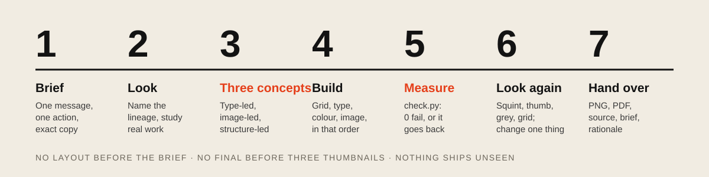

# Poster Designer

**A Claude Code agent that designs posters the way a studio does: brief first, three ideas before one, and nothing leaves until it has been measured.**

It writes each poster as HTML and CSS, renders it with a real browser to print-ready PNG and PDF, and checks the result with a script that fails on weak hierarchy, low contrast, text outside the margin, and any word the brief did not contain.


All three were made with the files in this repository. Sources and briefs are in [`examples/`](examples).

## The same brief, twice

The poster on the left is what you get when no decision is made: the default gradient, a centred stack, four typefaces, glow, emoji for icons, a discount nobody offered. The one on the right is the same brief after the process. The checker is run on both.


```text
$ python check.py slop.html --format ig-portrait --brief brief.json

FAIL  type      4 typefaces (Bebas Neue, Montserrat, Pacifico, Poppins). Use two: one to shout, one to explain.
FAIL  contrast  low contrast: 'Soda' 1.0:1 (needs 3.0); 'Lorem ipsum dolor sit amet, ' 2.2:1 (needs 4.5) ...
FAIL  copy      placeholder text on the poster: 'Lorem ipsum'
FAIL  copy      emoji used as graphics. Draw an icon or drop it.
FAIL  brief     text that is not in the brief (invented or mistyped): '50% OFF!'; 'Taste the Refreshing Difference!'; '100% Natural' ...
WARN  type      8 different text sizes. A poster needs 3 to 5 clear levels.
WARN  layout    almost everything is centred. A centred stack is the default; choose an axis, an edge or a deliberate asymmetry.
WARN  colour    7 separate hues in play. Pick 1 or 2 and give each a job; the rest should be neutrals.
WARN  colour    purple-to-blue or purple-to-pink gradient: the most recognisable generated-design default.
WARN  colour    frosted-glass panel (backdrop-filter): a web-UI habit, not a poster device.
WARN  colour    text-shadow on several pieces of text. Fix legibility with contrast or a plain panel, not glow.

5 fail, 6 warn, 3 pass
```

The last FAIL is the one that matters most. With `--brief`, every word on the sheet has to come from the brief. A poster cannot ship with an invented price, claim or award.

## How it works



| Step | What the agent produces |
|---|---|
| 1. Brief | `brief.json`: audience, the one message, the one action, format, viewing distance, and the exact copy |
| 2. Look | The design lineage it is working in, and notes on real references |
| 3. Three concepts | A type-led, an image-led and a structure-led thumbnail, side by side; one chosen, with the reason |
| 4. Build | Grid, then type scale, then colour, then image, in `poster.html` |
| 5. Measure | `check.py` at 0 FAIL; every WARN fixed or explained |
| 6. Look again | Squint, thumbnail, greyscale and grid renders, and one more pass |
| 7. Hand over | PNG, PDF, source, brief and a five-line rationale |

## The four looks

Every render also writes the views a designer checks by eye. Each has one question.


| View | Question |
|---|---|
| Grid and safe margin | Does every edge sit on a column? Is all text inside the margin? |
| Squint | Blurred, is there exactly one thing the eye lands on? |
| Greyscale | Without colour, is the order of importance still obvious? |
| Thumbnail | At postage-stamp size, can you still tell what it is about? |

## What gets measured

| Rule | Limit |
|---|---|
| Typefaces | 2 (3 warns, 4 fails) |
| Text sizes | 3 to 5 clear levels |
| Headline against reading size | 3× at least |
| Smallest text | at least 1.1% of the short side |
| Text inside the safe margin | always, unless marked as deliberate bleed |
| Contrast against the real rendered background | 4.5:1 small text, 3:1 large |
| Hues | 1 or 2 plus neutrals |
| Words | 70 at most |
| Placeholder text, emoji as icons | fail |
| Text that is not in the brief | fail |

Contrast is measured against what is actually behind each piece of text in the render (photographs, shapes, giant letters), not against a declared background colour.

## Install

Needs Python 3.10+ and [Claude Code](https://claude.com/claude-code).

```bash
pip install playwright pillow
```

```bash
python -m playwright install chromium
```

Windows:

```powershell
powershell -ExecutionPolicy Bypass -File install.ps1
```

macOS, Linux, Git Bash:

```bash
bash install.sh
```

This copies the agent to `~/.claude/agents/` and the skill to `~/.claude/skills/poster-design/`.

## Use

In Claude Code, ask for a poster. The agent is picked up from its description, or you can name it:

```text
Use the poster-designer agent. A3 poster for our team town hall on 4 December, 3 pm, 14th floor.
One message: bring one question. Use the optum-callcenter profile.
```

It will come back with the brief to confirm, then three concepts, then the finished files.

The scripts also work on their own:

```bash
python skills/poster-design/scripts/render.py examples/type-night/poster.html --format a3 --grid --pdf
```

```bash
python skills/poster-design/scripts/check.py examples/type-night/poster.html --format a3 --brief examples/type-night/brief.json
```

Formats: `a4` `a3` `a2` `tabloid` `letter` `ig-portrait` `ig-square` `story` `landscape` `og`, or any `WIDTHxHEIGHT`. One HTML file renders at any of them, because every size in the poster is a fraction of the sheet.

## Brand profiles

A profile is a small JSON file: colours by role, type roles with open-licence stand-ins, the brand's signature shape, tone, and rules that may never be broken. The floor-screen example above uses [`profiles/optum-callcenter.json`](skills/poster-design/profiles/optum-callcenter.json), made for internal customer-care posters.

That profile is **unofficial**. It was built by looking at the company's public website, and it exists as a starting point for someone on that team. It does not include the logo, the agent will not redraw one, and the company's own brand guide and logo files take priority over everything in it. See [`profiles/README.md`](skills/poster-design/profiles/README.md) for how to write a profile from a real brand guide.

## What is in the repository

```text
agents/poster-designer.md            the agent
skills/poster-design/
  SKILL.md                           definition of done, commands, measured rules
  references/process.md              the seven steps
  references/craft.md                hierarchy, grid, type, colour, image, lineages
  references/product-lighting.md     making a product look lit and placed, not pasted
  references/anti-slop.md            the habits that make work look generated, and the fixes
  references/formats.md              sizes, viewing distance, print and screen export
  profiles/                          brand profiles
  templates/base.html                starting sheet
  scripts/render.py                  HTML to PNG and PDF, plus the four looks
  scripts/check.py                   the checker
  scripts/sheet.py                   side-by-side sheets
examples/                            three posters with source and brief, and one bad one as a test case
docs/                                images used on this page
```

## Where the rules come from

- **Process:** the studio poster process taught in Gareth David Studio's *Design Process Master Class: Design Posters Like a Pro* (brief, research and mood boards, type, grids, sketching, build, variations, presentation).
- **Product lighting:** two Photoshop poster tutorials by Dharnyelpeter (two-tone ground, a chosen light source, clean cut-out edges, contact and cast shadows, light painted on the lit side, objects interleaved with shapes).
- **What good looks like:** side-by-side study of award-level typographic and festival posters against template and marketplace work.
- **Hierarchy, grids and restraint:** [Adobe on poster layout](https://www.adobe.com/express/learn/blog/poster-layout-design), [Creative Bloq on visual hierarchy](https://www.creativebloq.com/posters/4-rules-visual-hierarchy-poster-design-91516904), [Design Shack on poster anatomy](https://designshack.net/articles/graphics/anatomy-of-a-poster/), [Vistaprint on poster layout](https://www.vistaprint.com/hub/poster-layout), [Made Good on composition, type and colour](https://madegooddesigns.com/poster-design-guide/).
- **Signs of generated design:** [UX Collective on de-slopifying designs](https://uxdesign.cc/how-to-de-slopify-your-designs-4c40c57c1dc9), [Mika Reyes on spotting AI-made posters](https://mikareyes.com/ai/how-to-spot-ai-made-graphic-design-and-posters).

The three example posters use fictional events and products. Fonts are loaded from Google Fonts under their open licences.

## Licence

MIT. See [LICENSE](LICENSE).
