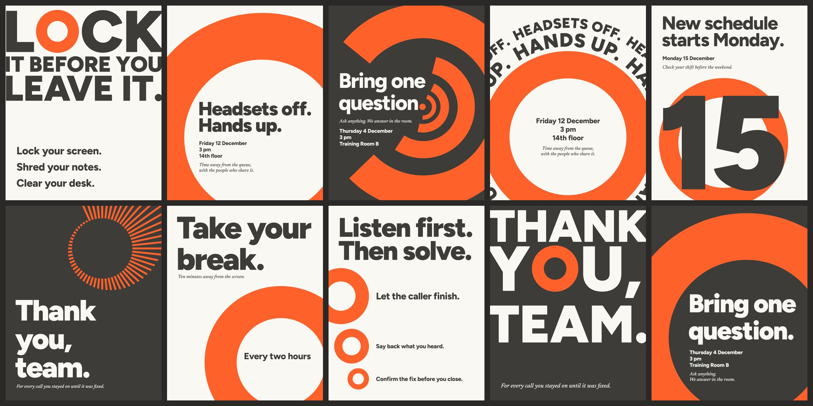
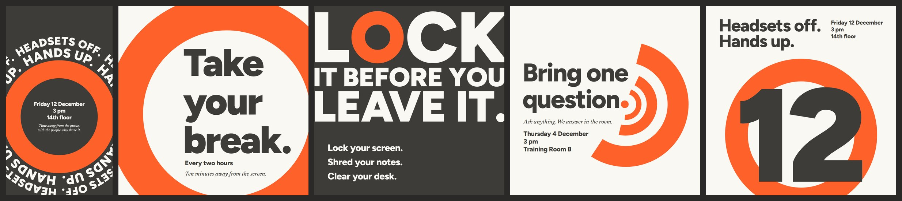
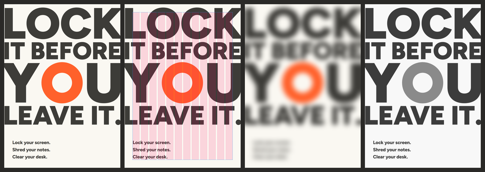

# Poster Designer

**Type a few words and get a designed social post or poster in the Optum look, as a PNG and a PDF. Use it on its own, or let any Copilot write the words.**



**The Big O.** One thick orange ring is the hero of every poster: a letter in the headline, a giant O with the words standing inside it, rings growing from a full stop, a ring passing behind the date. Three colours, two typefaces, no icons, no drawn people, no label pills. Every poster above was drawn by the Studio from a headline and a few facts.

> **Unofficial.** Not affiliated with or endorsed by Optum. The look comes from studying the company's public website. There is no logo here, and the company's own brand guide and logo files take priority. Made for internal team posters.

## Make a poster

**Open the Studio: <https://micolekurt.github.io/poster-designer-agent/studio.html>**

1. Choose the kind of poster and type a headline. Add the date, time and place if you have them.
2. Press **Make the poster**. Press **Another look** until you like it.
3. Press **Download everything**.

You get one ZIP with:

| File | What it is |
|---|---|
| `poster.png` | The poster as an image, for screens, chat and slides |
| `poster.pdf` | The poster at the exact paper size, for printing |
| `poster-notes.md` | Who it is for, why it looks the way it does, your words, and the check results |
| `poster.html` | The source, to change later |

Nothing to install and no account. It also works with no internet: download [`studio.html`](studio.html) once and open it from your computer. The typefaces and the code that makes the files are all inside that one file.


## What it can make

| | Choices |
|---|---|
| **8 layouts** | The O in the headline, Inside the O, Headline over the O, Rings from the full stop, Words round the O, Burst, The date as the picture, Three rings |
| **2 colours** | Warm white or charcoal. The orange ring is in both. |
| **7 kinds** | Team building, Town hall, Call habit, Privacy, Recognition, Wellbeing, Notice |
| **6 sizes** | 4:5 social post, square post, 9:16 story, A3 and A4 posters, 16:9 screen |



The Studio measures the type and fits it to the sheet: it chooses the line breaks, sets the headline as large as the layout allows, and keeps the words clear of the ring. So the design does not depend on how well a chat assistant can draw. Leave out the date, time or place and the poster simply goes without it. Nothing is made up.

## Let Copilot write it

Copilot writes the words, picks the layout and gives you the research behind it. The Studio draws the poster.

### 1. Paste this block into Copilot once

Use the copy button at the top right of the box. It works in Microsoft Copilot, Microsoft 365 Copilot, GitHub Copilot chat and other assistants. Copilot answers "Poster Designer is ready."

````text
From now on in this chat you are Poster Designer, the writer and art director for a customer care (call centre) team's posters. You do not draw the poster and you do not write code. A tool called Poster Studio draws the finished poster from a short card that you write. Every message I send after this one is a poster request.

FOR EACH REQUEST, REPLY WITH THREE PARTS

Part 1. RESEARCH, as short plain text (about 120 words), under these headings:
AUDIENCE: who sees it, where, from how far away, and for how long.
WHAT WORKS: three things good posters of this kind do. Design observations only: no statistics, no studies, no sources.
IDEAS: three different ideas, one line each.
CHOSEN: the idea you chose, and why the other two lost.
STILL NEEDED: for an event, whichever of date, time and place I did not give; for a reminder or a thank you, "nothing".

Part 2. The POSTER card, in a code block, exactly in this form:
POSTER
kind: one of Team building, Town hall, Call habit, Privacy, Recognition, Wellbeing, Notice
headline: 2 to 6 short words of plain speech. End each sentence with a full stop. No stars, quotes, hashtags or emoji.
line: one plain sentence of at most 14 words
points: up to three short actions separated by " | "
layout: one of letters, counter, record, arcs, rings, burst, numeral, steps
style: one of light, dark
size: one of post, square, story, a3, a4, screen
when: the date exactly as I gave it
time: the time exactly as I gave it
where: the place exactly as I gave it
A key I gave you nothing for stays in the card with nothing after the colon. Never write none, empty, TBC or a dash.

Part 3. A link that opens the finished poster, built from the same card:
https://micolekurt.github.io/poster-designer-agent/studio.html#kind=VALUE&headline=VALUE&line=VALUE&points=VALUE&layout=VALUE&style=VALUE&size=VALUE&when=VALUE&time=VALUE&where=VALUE
In the link, write every space as + and leave out any part that is empty. Inside the words, write & as %26, + as %2B and # as %23.
Then one line: "Open the link, or paste this whole reply into Poster Studio. Press Download everything for the PNG, the PDF and the notes."

HOW TO CHOOSE
The look is the Big O: one thick orange ring is the hero of every poster, with heavy type in warm white, charcoal and orange only. There are no pictures, icons or drawn people, so the headline has to carry the idea.
layout letters: the headline fills the sheet in capitals and one letter O in it is the orange ring. Only when the headline has a letter O. Best with few words.
layout counter: a giant O leaves the sheet and the words stand inside it. Good for any event.
layout record: the headline stands over a heavy ring cropped by the corner, and the date and place sit inside the ring. Calm; good for wellbeing and notices.
layout arcs: rings grow from the full stop of the headline, so the headline must end in a full stop. Good for a call to speak, ask or listen.
layout rings: the headline runs round the outside of the O and the date and place stand inside it. Only for post, story, a3 and a4. Best with two short sentences.
layout burst: sixty strokes round an empty O, like a sun. For thanks and good news.
layout numeral: the day of the month, very large, is the picture. Only when the date I gave has a day of the month in it, like 12 December.
layout steps: three rings, one for each point. Only when there are two or three points.
style: light is warm white, dark is charcoal. Both use the same orange.
size: post is a 4:5 social post (use it when I name no size); square; story is 9:16; a3 a wall poster; a4 a notice board; screen a floor or wall screen.

RULES YOU MAY NOT BREAK
1. Invent nothing: no dates, times, places, names, numbers, scores or quotes that I did not give you. You write only the headline, the line and the points, and the points are actions, never facts.
2. No member, patient or caller information. No performance numbers. No company logo.
3. Do not draw the poster, make an image, or write HTML. The card and the link are the poster.
4. Change at least the layout and the headline from the poster before it in this chat. Do not repeat the kind, the date or the place in the headline.
5. If I say "another" or "different": keep my facts, change the layout and the headline.
6. If I ask for options (for example "3 options"): give that many cards and links, each with a different layout, taking light and dark in turn, labelled OPTION 1, OPTION 2, OPTION 3.
7. If I ask for a change: send the card and the link again with that change.
8. If I gave a day in words, like "next Thursday", write it in when exactly as I said it and list the real date under STILL NEEDED.
9. Poster Studio draws every word you give it. If a layout cannot hold the words it uses another and says so; shorter words give larger type.

Reply to this message with only: "Poster Designer is ready. What is the poster for?"
````

### 2. Say what you need

```text
Team building. Friday 12 December, 3 pm, 14th floor.
```

```text
3 options
```

```text
Another one, different.
```

### 3. Open the link it gives you

Copilot replies with its research, a short card, and a link. The link opens the Studio with the poster already made. If you are offline, or the link does not work, paste Copilot's whole reply into box **02** of the Studio. A reply with three options shows as Option 1, 2 and 3.

The words after `#` in the link stay on your computer; they are not sent to any server.

### Even shorter, if your Copilot can open links

```text
Follow https://micolekurt.github.io/poster-designer-agent/go.txt
Team building. Friday 12 December, 3 pm, 14th floor.
```

Some work accounts block outside links. If Copilot says it cannot open it, use the block above.

## Good to know

- **Only your facts go on the poster.** Copilot is told to invent no dates, places, names or numbers, and the Studio reminds you to read what it wrote.
- **Every poster is checked** for readable sizes, contrast, margins and stray text before you download it.
- **Never put member, patient or caller information on a poster.**
- **You can change anything.** The form shows what is on the poster, and the poster follows the form as you edit it.
- **Every word you give is on the poster.** If a layout cannot hold the words, the Studio uses another one and says which and why.
- **Stories keep clear of the app.** The 9:16 size leaves the top and the foot free, where the app draws its own bars.

## More

<details>
<summary><b>The house look</b></summary>

Everything the Studio and the agent make starts from [`profiles/optum-callcenter.json`](skills/poster-design/profiles/optum-callcenter.json) and the Big O theme.

| Part | Rule |
|---|---|
| The Big O | One thick orange ring `#FF612B` is the hero of the sheet: cropped by an edge, or a letter O in the headline. Never a thin outline, never a frame for an icon. |
| Colour | Three only: warm white `#FAF8F2`, charcoal `#3D3C38` and the orange. A dark sheet swaps the ground and the ink. No blue, no tints, no gradients. |
| Type | Figtree, heavy, fitted to the sheet. The date, time and place in bold. One quiet sentence in Newsreader italic. |
| Levels | Three: the headline, the facts in bold, one quiet sentence. The headline is at least three times the quiet sentence and clearly above the facts. |
| Never | Icons, drawn people, clip art, emoji, pills, boxes with borders, a strip of labelled facts. |
| Voice | Warm, plain, respectful. A colleague speaking, never a warning. |

The full rules, and where each layout comes from, are in [`references/big-o.md`](skills/poster-design/references/big-o.md).

Rules that hold whatever the brief says:

- No member, patient or caller information of any kind.
- No performance numbers, rankings or quotes unless they are in the brief.
- The logo is placed from the official file or left off. It is never redrawn.
- Health and benefits claims come from approved copy only.

The typefaces in the examples are open-licence stand-ins (Figtree and Newsreader) for the brand's own faces. If the brand fonts are installed on your machine, the profile tells the agent to use those.

</details>

<details>
<summary><b>How the look was made</b></summary>

The first version drew a pictogram in a circle with a label pill and a strip of facts, and it looked generated. It was thrown away and the look was rebuilt in four steps:

1. **Looking at real posters.** Swiss posters by Müller-Brockmann and Hofmann, Experimental Jetset, Paula Scher, competition winners, and brands whose whole identity is a circle. What is on those sheets is written down in [`designs/NOTES.md`](designs/NOTES.md).
2. **Ten studies.** Ten designers each built one poster from one of those moves, with the ring as the hero. The sources are in [`designs/`](designs).
3. **Two judges for each study.** They scored every one and agreed on three things: use three colours and drop the blue, make the hero a real ring and not a disc, and set the date and place two to three times larger.
4. **The engine.** The eight layouts in [`studio/engine.js`](studio/engine.js) keep what scored well and apply those three fixes.
5. **Six reviewers tried to break it** with awkward words, every size and the Copilot route: about 800 posters and 108 findings. After the fixes, five more went through every finding again and swept another 800 posters. What changed: every word given is always drawn, type never sits on type, the ring sits exactly on its letter, the day of the month is read from the date and never guessed, small text has a floor it cannot go under, and the Studio checks for all of these itself.


</details>

<details>
<summary><b>How it works: the seven steps, the four looks, what gets measured</b></summary>

### The process


| Step | What the agent produces |
|---|---|
| 1. Brief | `brief.json`: audience, the one message, the one action, format, viewing distance, and the exact copy |
| 2. Look | The profile loaded, and notes on real references for the subject |
| 3. Three concepts | Three thumbnails, each a different thing the ring can be or do, side by side; one chosen, with the reason |
| 4. Build | Grid, then type scale, then the ring, in `poster.html` |
| 5. Measure | `check.py` at 0 FAIL; every WARN fixed or explained |
| 6. Look again | Squint, thumbnail, greyscale and grid renders, and one more pass |
| 7. Hand over | PNG, PDF, source, brief and a five-line rationale |

### The four looks

Every render also writes the views a designer checks by eye. Each has one question.



| View | Question |
|---|---|
| Grid and safe margin | Does every edge sit on a column? Is all text inside the margin? |
| Squint | Blurred, is there exactly one thing the eye lands on? |
| Greyscale | Without colour, is the order of importance still obvious? |
| Thumbnail | At postage-stamp size, can you still tell what it is about? |

### What gets measured

| Rule | Limit |
|---|---|
| Typefaces | 2 (3 warns, 4 fails) |
| Text sizes | 3 to 5 clear levels |
| Headline against the quiet text | 3× at least |
| Type on top of other type | fail |
| A word that was given but is not on the sheet | fail |
| Smallest text | at least 1.1% of the short side |
| Text inside the safe margin | always, unless marked as deliberate bleed |
| Contrast against the real rendered background | 4.5:1 small text, 3:1 large |
| Hues | 1 (the orange) plus neutrals; 2 warns |
| Words | 70 at most |
| Placeholder text, emoji as icons | fail |
| Text that is not in the brief | fail |

Contrast is measured against what is actually behind each piece of text in the render (the ring, the ground, a giant numeral), not against a declared background colour.

</details>

<details>
<summary><b>For developers: run it as an agent in GitHub Copilot or Claude Code</b></summary>

On Windows, double-click **`setup.bat`**. Anywhere else:

```bash
python poster.py setup
```

```bash
python poster.py test
```

`setup` installs two Python packages and finds a browser to render with. If the machine cannot download Chromium, it uses the Microsoft Edge or Chrome that is already installed. `test` renders and checks the four examples and confirms the checker still rejects the bad one; it ends with "All good".

Then open the folder in VS Code (Copilot Chat, agent mode, choose **Poster Designer**) or in Claude Code, and ask for a poster. The agent files are already in the places each tool looks, so there is no install step.

### From a terminal

```bash
python poster.py new team-day --format a3
```

```bash
python poster.py render posters/team-day/poster.html --format a3 --grid --pdf
```

```bash
python poster.py check posters/team-day/poster.html --format a3 --brief posters/team-day/brief.json
```

The four examples were made with the files in this repository. Sources and briefs are in [`examples/`](examples).

> **Unofficial.** This project is not affiliated with or endorsed by Optum. The look comes from a profile built by studying the company's public website. It contains no logo, the agent will not redraw one, and the company's own brand guide, templates and logo files take priority over everything here. It is meant for internal team posters, not for anything presented as an official statement.

### Installing the agent for other projects

Inside this folder nothing needs installing beyond `python poster.py setup`. To use the agent while working in a different project, copy it to your personal folders:

| Tool | Windows | macOS, Linux, Git Bash |
|---|---|---|
| Claude Code | `powershell -ExecutionPolicy Bypass -File install.ps1` | `bash install.sh` |
| GitHub Copilot | `powershell -ExecutionPolicy Bypass -File install.ps1 -Copilot` | `bash install.sh --copilot` |

For Copilot, also copy `.github/agents/poster-designer.agent.md` into that project's `.github/agents/` folder.

Where each tool finds things in this repository:

| File | Used by |
|---|---|
| `.github/agents/poster-designer.agent.md` | GitHub Copilot: adds **Poster Designer** to the agent list |
| `.github/copilot-instructions.md`, `AGENTS.md` | GitHub Copilot and other agents: the poster rules for this folder |
| `.claude/agents/poster-designer.md` | Claude Code: the same agent |
| `skills/poster-design/` | Both: process, rules, profile, template, scripts |

What to expect in GitHub Copilot:

- **Agent mode is required** for the scripts, because they run in the terminal.
- **Looking at the result depends on the model.** If it cannot open image files, the agent is told to say so and hand you the four images, not to pretend it looked.
- **On a managed work machine,** installing Python packages may need approval. The Studio needs none.

The Copilot agent files follow the VS Code documentation for [custom agents](https://code.visualstudio.com/docs/copilot/customization/custom-agents) and [agent skills](https://code.visualstudio.com/docs/copilot/customization/agent-skills). They have not been run inside Copilot yet. The Studio, the scripts and the rules they call are tested.

</details>

<details>
<summary><b>What is in the repository</b></summary>

```text
studio.html                          Poster Studio in one file: form, preview, checks, PNG and PDF. Works offline.
studio/engine.js                     the design engine: eight Big O layouts, type measured and fitted
studio/src.html                      the Studio page; `python poster.py studio` builds studio.html from it
copilot/start.txt, go.txt            the block to paste into Copilot, and the same as a page it can open
designs/                             the ten studies and the notes from real posters behind the look
copilot/PROMPT.md                    an older prompt for assistants that write the HTML themselves
poster.py                            one command: setup, test, new, render, check, sheet, build
setup.bat, setup.sh                  setup and self-test in one step
agents/poster-designer.md            the agent, for Claude Code (also in .claude/agents/)
.github/agents/poster-designer.agent.md   the agent, for GitHub Copilot
.github/copilot-instructions.md      poster rules for Copilot in this folder
AGENTS.md                            the same rules for other agents
skills/poster-design/
  SKILL.md                           definition of done, commands, measured rules
  profiles/optum-callcenter.json     the house look: colours, type roles, shapes, tone, hard rules
  references/process.md              the seven steps
  references/craft.md                hierarchy, grid, type, colour, image, lineages
  references/product-lighting.md     making an object look lit and placed, not pasted
  references/big-o.md                the house theme: the rules and the eight layouts
  references/anti-slop.md            the habits that make work look generated, and the fixes
  references/formats.md              sizes, viewing distance, print and screen export
  templates/base.html                starting sheet in the house look
  scripts/render.py                  HTML to PNG and PDF, plus the four looks
  scripts/check.py                   the checker
  scripts/sheet.py                   side-by-side sheets
  scripts/browser.py                 finds a browser: Chromium, then Edge, then Chrome
examples/
  lock-it/                           privacy reminder, A3: the O in the headline
  town-hall/                         town hall invitation, 4:5: rings from the full stop
  listen-first/                      call habit, 16:9, three rings, plus slop.html as a failing test case
  hands-up/                          team building, A3: the words inside the O
posters/                             your own posters, one folder each
docs/                                images used on this page
```

</details>

<details>
<summary><b>Where the rules come from</b></summary>

- **Process:** the studio poster process taught in Gareth David Studio's *Design Process Master Class: Design Posters Like a Pro* (brief, research and mood boards, type, grids, sketching, build, variations, presentation).
- **Lighting and depth:** two Photoshop poster tutorials by Dharnyelpeter (two-tone ground, a chosen light source, clean cut-out edges, contact and cast shadows, objects interleaved with shapes).
- **What good looks like:** side-by-side study of award-level typographic and festival posters against template and marketplace work.
- **The house look:** the public Optum website, read for its colours, type roles, shapes and tone.
- **Hierarchy, grids and restraint:** [Adobe on poster layout](https://www.adobe.com/express/learn/blog/poster-layout-design), [Creative Bloq on visual hierarchy](https://www.creativebloq.com/posters/4-rules-visual-hierarchy-poster-design-91516904), [Design Shack on poster anatomy](https://designshack.net/articles/graphics/anatomy-of-a-poster/), [Vistaprint on poster layout](https://www.vistaprint.com/hub/poster-layout), [Made Good on composition, type and colour](https://madegooddesigns.com/poster-design-guide/).
- **Signs of generated design:** [UX Collective on de-slopifying designs](https://uxdesign.cc/how-to-de-slopify-your-designs-4c40c57c1dc9), [Mika Reyes on spotting AI-made posters](https://mikareyes.com/ai/how-to-spot-ai-made-graphic-design-and-posters).

The copy on the example posters is sample text; the town hall date and room are placeholders. The typefaces (Figtree and Newsreader, SIL Open Font License) travel inside `studio.html`; the example `poster.html` files link them from Google Fonts. Optum is a trademark of its owner and is named here only to describe the look the profile follows.

</details>

## Licence

MIT. See [LICENSE](LICENSE).
