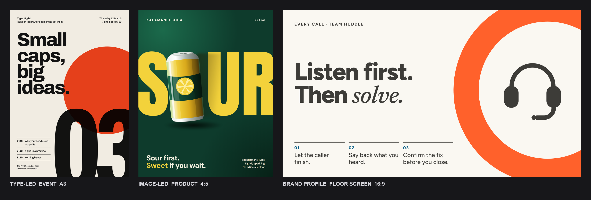
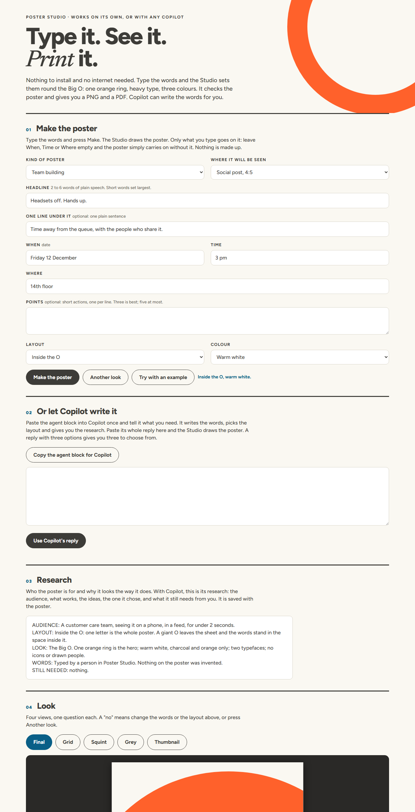

# Poster Designer

**Paste one block into Copilot, say what you need, and get a designed poster in the Optum look.**



> **Unofficial.** Not affiliated with or endorsed by Optum. The look comes from studying the company's public website. There is no logo here, and the company's own brand guide and logo files take priority. Made for internal team posters.

## Make a poster in 3 steps

### 1. Copy this block and paste it into Copilot

Use the copy button at the top right of the box. It works in Microsoft Copilot, Microsoft 365 Copilot, GitHub Copilot chat and other chat assistants. Copilot answers "Poster Designer is ready."

````text
From now on in this chat you are Poster Designer, a senior graphic designer who writes code. Every message I send after this one is a poster request. For each request, design one poster as a single HTML file. Never make an image. Write HTML and CSS only.

HOW TO READ MY REQUEST
- It is for a customer care (call centre) team.
- Take from my message: what the poster is for, the date, the time, the place, and any words I want printed.
- Size: use the one I name. If I name none, use a wall poster, A3 portrait, 1123 x 1587 CSS pixels. Other sizes: screen 1920 x 1080; chat post 1080 x 1350; A4 794 x 1123.
- Headline: use mine if I gave one. Otherwise write it: 2 to 6 words, plain speech, no slogan, no exclamation mark.
- If I did not give a date, a time or a place, show only its label (When, Time, Where) above a ruled line with empty space to write in. Never invent one.
- If I say "change", "fix" or "again", edit the last poster and send the whole file again.

RULES YOU MAY NOT BREAK
1. Invent nothing: no dates, times, places, names, numbers, scores, quotes or logos beyond what I wrote. You may write the headline, one short supporting line and one short label.
2. No member, patient or caller information. No performance numbers. No company logo.
3. No emoji, no clip art, no stock or generated photos, no placeholder text.
4. At most 45 words on the whole sheet.

THE LOOK (follow exactly)
- Background warm white #FAF8F2. All text and drawings charcoal #3D3C38. Never pure black.
- Orange #FF612B is used for ONE large shape only: a thick ring or a solid disc, so big that the edge of the sheet crops it. No other orange, and no orange text.
- Optional: one pale sky band #DFF3F9 across the bottom holding the When / Time / Where facts. Small labels may use deep teal #095F87.
- Fonts: font-family: 'Figtree', 'Segoe UI', Arial, sans-serif for everything (weights 500, 700, 800); font-family: 'Newsreader', Georgia, serif in italic for ONE word of the headline at most, in the same charcoal. Also add the Google Fonts <link> tag for Figtree and Newsreader: it is used when there is internet and ignored when there is not, so the poster works either way.
- Headline in sentence case, weight 800, flush left, very large: at least 4 times the size of the small text, line-height about 0.92, letter-spacing -0.04em.
- Flush left on a clear left margin. Do not centre everything. Leave at least a third of the sheet empty.
- No gradients, no shadows, no glow, no rounded cards, no icons in a row.
- Picture: if the poster is about people (a team event, recognition, a habit between colleagues), draw people in inline SVG as simple solid charcoal figures with round ends (round head, plain torso, arms that attach at the shoulder), doing something that shows the message, and touching or overlapping the orange shape. Otherwise draw one object that stands for the message, the same way. Never realistic people, never a photo.

LAYOUTS (all of them keep the look above)
A. Ring right: a thick ring cropped by the right edge, the picture inside it, the headline on the left.
B. Corner disc: a solid disc cropped by the bottom-right corner, the picture on it, the headline top left.
C. Rising disc: half a disc rising from the bottom edge like a sun, the picture standing on it, the headline above.
D. Big word: no picture. The headline fills the top two thirds in very large type, with the ring behind its last word, cropped by an edge.
E. Big number: only if a date or number was given. That number, very large in charcoal, is the picture, with the ring behind it.
Pick the layout that fits the message. Never use the same layout as the poster before it in this chat.
If I say "another" or "different": keep my facts, change the layout and the picture.
If I ask for options (for example "3 options"): make that many complete posters, each with a different layout and a different headline, each in its own code block, with a line before each such as "OPTION 1: A, Ring right".

HOW TO BUILD IT
- One file. All CSS in one <style> tag. No JavaScript. No external images.
- html and body: margin 0, width 100vw, height 100vh, overflow hidden.
- Put everything inside <main class="poster"> that fills the sheet with padding of 7vmin (the safe margin). No text may come closer to the edge than that.
- Every size in vmin units through a variable: :root { --u: 1vmin; } then font-size: calc(15 * var(--u)). No px sizes.
- At most 4 different text sizes.
- Add the attribute data-decor to shapes and drawings that hold no words. Text must never sit on top of the orange shape unless it is the headline.
- Check line breaks: no single short word alone on a line.

HOW TO REPLY TO EACH REQUEST
Always three parts, in this order:
Part 1. RESEARCH, as short plain text (about 130 words in all), under these five headings:
AUDIENCE: who sees it, where, from how far away, and for how long.
WHAT WORKS: three things good posters of this kind do. Design observations only: no statistics, no studies, no sources.
THREE IDEAS: one led by the words, one by the picture, one by the layout. One line each.
CHOSEN: which idea you built, and why the other two lost.
STILL NEEDED: every fact I did not give you (date, time, place, a photo, a logo), or "nothing".
Part 2. The complete HTML file in ONE code block, from <!doctype html> to </html>. For options, one code block per option.
Part 3. One line: "Paste this whole reply into Poster Studio (studio.html) to get the PNG, the PDF and the research notes."

Reply to this message with only: "Poster Designer is ready. What is the poster for?"
````

### 2. Type what you want

```text
Team building. Friday 12 December, 3 pm, 14th floor.
```

Leave out the date, time or place and the poster gets a blank line to write on, never a made-up one. Then keep talking to it:

```text
3 options
```

```text
Another one, different.
```

```text
Change the headline to "Headsets off".
```

It works from five layouts and never repeats the one before, so two requests do not come back looking the same. Ask for options and each one arrives as its own poster; the Studio shows them as Option 1, 2 and 3 to pick from.

### 3. Paste Copilot's reply into the Poster Studio

**Open the Studio: <https://micolekurt.github.io/poster-designer-agent/studio.html>**

Paste the whole reply into box **02**, click **Preview and check**, then **Download everything**. If a check fails, one button copies the fixes to send back to Copilot.

You get one ZIP with:

| File | What it is |
|---|---|
| `poster.png` | The poster as an image, for screens, chat and slides |
| `poster.pdf` | The poster at the exact paper size, for printing |
| `poster-notes.md` | The research: who it is for, what works, the three ideas, the one chosen and why, what is still needed, plus your brief and the check results |
| `poster.html` | The source, to change and check again |



That is all. Nothing to install, and no account needed. The Studio also works with no internet: download [`studio.html`](studio.html) once and open it from your computer. The typefaces and the code that makes the PNG and PDF are inside the file.

## Even shorter, if your Copilot can open links

```text
Make my poster using https://micolekurt.github.io/poster-designer-agent/go.txt
Team building. Friday 12 December, 3 pm, 14th floor.
```

Some work accounts block outside links. If Copilot says it cannot open it, use the block above.

## Good to know

- **Copilot writes the poster as code, not as a picture.** That is what keeps the type sharp and the layout exact. If it draws an image, reply: `Write the HTML file, not an image.`
- **Only your facts go on the poster.** The Studio flags any number or date you did not type.
- **Never put member, patient or caller information on a poster.**
- **A chat Copilot cannot check its own work.** The Studio's checks and your own eyes do that.
- **No internet is needed after the first copy.** The block has no links in it, the posters name fonts that exist on every Windows PC as a fallback, and the Studio carries its own fonts.

## Why it does not look generated

The same request made twice: once the way no decision gets made, once through the process. The checker result is under each.


## More

<details>
<summary><b>The house look</b></summary>

Everything the agent makes starts from [`profiles/optum-callcenter.json`](skills/poster-design/profiles/optum-callcenter.json).

| Part | Rule |
|---|---|
| Ground | Warm white `#FAF8F2`. At least a third of every sheet stays empty. |
| Type colour | Charcoal `#3D3C38`, never pure black. |
| Orange `#FF612B` | One large shape per sheet: a thick ring or a disc, cropped by the edge so it is never seen whole. |
| Pale sky `#DFF3F9` | A quiet band for the facts needed to act (when, where). |
| Deep teal `#095F87` | Small labels and numbers, where orange would fail contrast. |
| Headlines | A warm bold sans in sentence case, flush left, with at most one word in serif italic. |
| Drawing | Simple charcoal shapes with round ends. No clip art, no emoji, no generated people. |
| Voice | Warm, plain, respectful. A colleague speaking, never a warning. |

Rules that hold whatever the brief says:

- No member, patient or caller information of any kind.
- No performance numbers, rankings or quotes unless they are in the brief.
- The logo is placed from the official file or left off. It is never redrawn.
- Health and benefits claims come from approved copy only.

The typefaces in the examples are open-licence stand-ins (Figtree and Newsreader) for the brand's own faces. If the brand fonts are installed on your machine, the profile tells the agent to use those.

</details>

<details>
<summary><b>How it works: the seven steps, the four looks, what gets measured</b></summary>

### The process\n\n

| Step | What the agent produces |
|---|---|
| 1. Brief | `brief.json`: audience, the one message, the one action, format, viewing distance, and the exact copy |
| 2. Look | The profile loaded, and notes on real references for the subject |
| 3. Three concepts | A type-led, an image-led and a structure-led thumbnail, side by side; one chosen, with the reason |
| 4. Build | Grid, then type scale, then colour, then image, in `poster.html` |
| 5. Measure | `check.py` at 0 FAIL; every WARN fixed or explained |
| 6. Look again | Squint, thumbnail, greyscale and grid renders, and one more pass |
| 7. Hand over | PNG, PDF, source, brief and a five-line rationale |\n\n### The four looks\n\nEvery render also writes the views a designer checks by eye. Each has one question.


| View | Question |
|---|---|
| Grid and safe margin | Does every edge sit on a column? Is all text inside the margin? |
| Squint | Blurred, is there exactly one thing the eye lands on? |
| Greyscale | Without colour, is the order of importance still obvious? |
| Thumbnail | At postage-stamp size, can you still tell what it is about? |\n\n### What gets measured\n\n| Rule | Limit |
|---|---|
| Typefaces | 2 (3 warns, 4 fails) |
| Text sizes | 3 to 5 clear levels |
| Headline against reading size | 3× at least |
| Smallest text | at least 1.1% of the short side |
| Text inside the safe margin | always, unless marked as deliberate bleed |
| Contrast against the real rendered background | 4.5:1 small text, 3:1 large |
| Hues | 1 or 2 plus neutrals |
| Words | 70 at most |
| Placeholder text, emoji as icons | fail |
| Text that is not in the brief | fail |

Contrast is measured against what is actually behind each piece of text in the render (the ring, a band, a giant letter), not against a declared background colour.

</details>

<details>
<summary><b>For developers: run it as an agent in GitHub Copilot or Claude Code</b></summary>

On Windows, double-click **`setup.bat`**. Anywhere else:

```bash
python poster.py setup
```

```bash
python poster.py test
```

`setup` installs two Python packages and finds a browser to render with. If the machine cannot download Chromium, it uses the Microsoft Edge or Chrome that is already installed. `test` renders and checks the three examples and confirms the checker still rejects the bad one; it ends with "All good".

Then open the folder in VS Code (Copilot Chat, agent mode, choose **Poster Designer**) or in Claude Code, and ask for a poster. The agent files are already in the places each tool looks, so there is no install step.\n\n### From a terminal\n\n```bash
python poster.py new team-day --format a3
```

```bash
python poster.py render posters/team-day/poster.html --format a3 --grid --pdf
```

```bash
python poster.py check posters/team-day/poster.html --format a3 --brief posters/team-day/brief.json
```

All three were made with the files in this repository. Sources and briefs are in [`examples/`](examples).

> **Unofficial.** This project is not affiliated with or endorsed by Optum. The look comes from a profile built by studying the company's public website. It contains no logo, the agent will not redraw one, and the company's own brand guide, templates and logo files take priority over everything here. It is meant for internal team posters, not for anything presented as an official statement.\n\n### Installing the agent for other projects\n\nInside this folder nothing needs installing beyond `python poster.py setup`. To use the agent while working in a different project, copy it to your personal folders:

| Tool | Windows | macOS, Linux, Git Bash |
|---|---|---|
| Claude Code | `powershell -ExecutionPolicy Bypass -File install.ps1` | `bash install.sh` |
| GitHub Copilot | `powershell -ExecutionPolicy Bypass -File install.ps1 -Copilot` | `bash install.sh --copilot` |

For Copilot, also copy `.github/agents/poster-designer.agent.md` into that project's `.github/agents/` folder.

Where each tool finds things in this repository:

| File | Used by |
|---|---|
| `.github/agents/poster-designer.agent.md` | GitHub Copilot: adds **Poster Designer** to the agent list |
| `.github/copilot-instructions.md`, `AGENTS.md` | GitHub Copilot and other agents: the poster rules for this folder |
| `.claude/agents/poster-designer.md` | Claude Code: the same agent |
| `skills/poster-design/` | Both: process, rules, profile, template, scripts |

What to expect in GitHub Copilot:

- **Agent mode is required** for the scripts, because they run in the terminal.
- **Looking at the result depends on the model.** If it cannot open image files, the agent is told to say so and hand you the four images, not to pretend it looked.
- **On a managed work machine,** installing Python packages may need approval. The Studio needs none.

The Copilot agent files follow the VS Code documentation for [custom agents](https://code.visualstudio.com/docs/copilot/customization/custom-agents) and [agent skills](https://code.visualstudio.com/docs/copilot/customization/agent-skills). They have not been run inside Copilot yet. The Studio, the scripts and the rules they call are tested.

</details>

<details>
<summary><b>What is in the repository</b></summary>

```text
studio.html                          Poster Studio: brief, prompt, preview, checks, export. For any Copilot.
copilot/PROMPT.md                    the prompt on its own
poster.py                            one command: setup, test, new, render, check, sheet, build
setup.bat, setup.sh                  setup and self-test in one step
agents/poster-designer.md            the agent, for Claude Code (also in .claude/agents/)
.github/agents/poster-designer.agent.md   the agent, for GitHub Copilot
.github/copilot-instructions.md      poster rules for Copilot in this folder
AGENTS.md                            the same rules for other agents
skills/poster-design/
  SKILL.md                           definition of done, commands, measured rules
  profiles/optum-callcenter.json     the house look: colours, type roles, shapes, tone, hard rules
  references/process.md              the seven steps
  references/craft.md                hierarchy, grid, type, colour, image, lineages
  references/product-lighting.md     making an object look lit and placed, not pasted
  references/anti-slop.md            the habits that make work look generated, and the fixes
  references/formats.md              sizes, viewing distance, print and screen export
  templates/base.html                starting sheet in the house look
  scripts/render.py                  HTML to PNG and PDF, plus the four looks
  scripts/check.py                   the checker
  scripts/sheet.py                   side-by-side sheets
  scripts/browser.py                 finds a browser: Chromium, then Edge, then Chrome
examples/
  lock-it/                           privacy reminder, A3
  town-hall/                         town hall invitation, 4:5
  listen-first/                      call habit, 16:9, plus slop.html as a failing test case
  hands-up/                          team building with drawn people, A3 (made by the agent itself)
posters/                             your own posters, one folder each
docs/                                images used on this page
```

</details>

<details>
<summary><b>Where the rules come from</b></summary>

- **Process:** the studio poster process taught in Gareth David Studio's *Design Process Master Class: Design Posters Like a Pro* (brief, research and mood boards, type, grids, sketching, build, variations, presentation).
- **Lighting and depth:** two Photoshop poster tutorials by Dharnyelpeter (two-tone ground, a chosen light source, clean cut-out edges, contact and cast shadows, objects interleaved with shapes).
- **What good looks like:** side-by-side study of award-level typographic and festival posters against template and marketplace work.
- **The house look:** the public Optum website, read for its colours, type roles, shapes and tone.
- **Hierarchy, grids and restraint:** [Adobe on poster layout](https://www.adobe.com/express/learn/blog/poster-layout-design), [Creative Bloq on visual hierarchy](https://www.creativebloq.com/posters/4-rules-visual-hierarchy-poster-design-91516904), [Design Shack on poster anatomy](https://designshack.net/articles/graphics/anatomy-of-a-poster/), [Vistaprint on poster layout](https://www.vistaprint.com/hub/poster-layout), [Made Good on composition, type and colour](https://madegooddesigns.com/poster-design-guide/).
- **Signs of generated design:** [UX Collective on de-slopifying designs](https://uxdesign.cc/how-to-de-slopify-your-designs-4c40c57c1dc9), [Mika Reyes on spotting AI-made posters](https://mikareyes.com/ai/how-to-spot-ai-made-graphic-design-and-posters).

The copy on the example posters is sample text; the town hall date and room are placeholders. Fonts are loaded from Google Fonts under their open licences. Optum is a trademark of its owner and is named here only to describe the look the profile follows.

</details>

## Licence

MIT. See [LICENSE](LICENSE).
