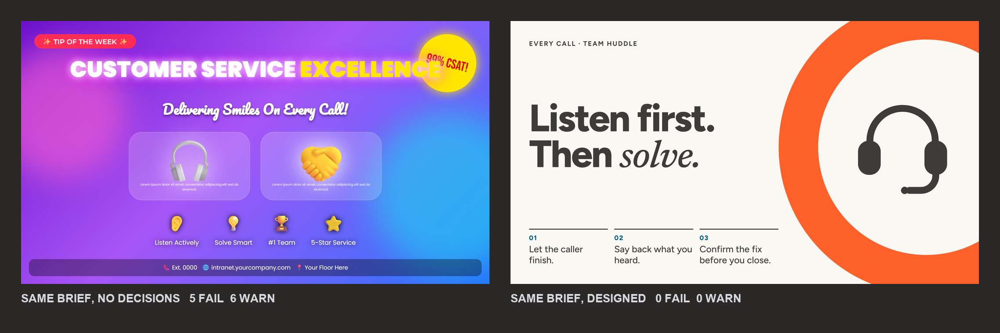

# Poster Designer

**An agent for Claude Code and GitHub Copilot that designs posters for a customer care floor in the Optum look, the way a studio does: brief first, three ideas before one, and nothing leaves until it has been measured.**

It writes each poster as HTML and CSS, renders it with a real browser to print-ready PNG and PDF, and checks the result with a script that fails on weak hierarchy, low contrast, text outside the margin, and any word the brief did not contain.


## Use it from a link

Nothing to download.

**Poster Studio online:** <https://micolekurt.github.io/poster-designer-agent/studio.html>

**In a Copilot that can open links,** paste this and add your details:

```text
Make my poster using https://micolekurt.github.io/poster-designer-agent/go.txt
Team building. Friday 12 December, 3 pm, 14th floor.
```

The first line never changes. The second line is your poster, in your own words.

Copilot answers with one HTML file. Paste its reply into the Studio to check it and export a PDF or PNG.

A chat Copilot can read the instructions from the link, but it cannot run this repository's scripts. Some Copilots, especially on managed work accounts, are not allowed to open outside links; if yours says it cannot, use the Studio's **Copy the prompt for Copilot** button and paste the prompt itself.

## Three ways to run it

Copy the folder (clone it, download the ZIP, or carry it on a USB stick) and pick the one that fits where you are.

| You have | Do this | Needs |
|---|---|---|
| **Any Copilot or chat assistant** (Microsoft Copilot, Microsoft 365 Copilot, GitHub Copilot chat) | Double-click **`studio.html`** | A browser. Nothing to install. |
| **GitHub Copilot in agent mode, or Claude Code** | Open the folder and ask the **Poster Designer** agent for a poster | Python, set up with one command |
| **Just a terminal** | `python poster.py new team-day`, then `render` and `check` | Python, set up with one command |

### 1. Any Copilot: Poster Studio

`studio.html` is one file that works offline in Edge or Chrome. It does the parts a chat assistant cannot.


1. **Fill in the brief.** Only what you type is allowed on the poster as fact. An empty date becomes a blank line to write on, never a made-up one.
2. **Copy the prompt** and paste it into Copilot. It carries the whole look and the rules.
3. **Paste Copilot's reply back.** The Studio finds the HTML in it and draws the poster at its real size.
4. **Look and check.** Grid, squint, grey and thumbnail views, plus measured checks. Numbers or dates you did not give are a FAIL. One button copies the fixes to send back to Copilot.
5. **Export** a PDF for print or a PNG for screens and chat.

The prompt on its own is in [`copilot/PROMPT.md`](copilot/PROMPT.md).

What a chat Copilot cannot do is run the full checker or look at its own work, so the Studio's checks and your own eyes do that. The Python checker is still the stricter one (it measures contrast against photographs too).

### 2. An agent: GitHub Copilot or Claude Code

On Windows, double-click **`setup.bat`**. Anywhere else:

```bash
python poster.py setup
```

```bash
python poster.py test
```

`setup` installs two Python packages and finds a browser to render with. If the machine cannot download Chromium, it uses the Microsoft Edge or Chrome that is already installed. `test` renders and checks the three examples and confirms the checker still rejects the bad one; it ends with "All good".

Then open the folder in VS Code (Copilot Chat, agent mode, choose **Poster Designer**) or in Claude Code, and ask for a poster. The agent files are already in the places each tool looks, so there is no install step.

### 3. A terminal

```bash
python poster.py new team-day --format a3
```

```bash
python poster.py render posters/team-day/poster.html --format a3 --grid --pdf
```

```bash
python poster.py check posters/team-day/poster.html --format a3 --brief posters/team-day/brief.json
```

All three were made with the files in this repository. Sources and briefs are in [`examples/`](examples).

> **Unofficial.** This project is not affiliated with or endorsed by Optum. The look comes from a profile built by studying the company's public website. It contains no logo, the agent will not redraw one, and the company's own brand guide, templates and logo files take priority over everything here. It is meant for internal team posters, not for anything presented as an official statement.

## The same brief, twice

The slide on the left is what you get when no decision is made: the default gradient, a centred stack, four typefaces, glow, emoji for icons, and a satisfaction score nobody supplied. The one on the right is the same brief after the process. The checker is run on both.



```text
$ python check.py slop.html --format landscape --brief brief.json

FAIL  type      4 typefaces (Bebas Neue, Montserrat, Pacifico, Poppins). Use two: one to shout, one to explain.
FAIL  contrast  low contrast: 'Excellence' 1.0:1 (needs 3.0); 'Lorem ipsum dolor sit amet, ' 2.8:1 (needs 4.5) ...
FAIL  copy      placeholder text on the poster: 'Lorem ipsum'
FAIL  copy      emoji used as graphics. Draw an icon or drop it.
FAIL  brief     text that is not in the brief (invented or mistyped): '99% CSAT!'; 'Customer Service'; 'Delivering Smiles On Every Call!' ...
WARN  type      8 different text sizes. A poster needs 3 to 5 clear levels.
WARN  layout    almost everything is centred. A centred stack is the default; choose an axis, an edge or a deliberate asymmetry.
WARN  colour    7 separate hues in play. Pick 1 or 2 and give each a job; the rest should be neutrals.
WARN  colour    purple-to-blue or purple-to-pink gradient: the most recognisable generated-design default.
WARN  colour    frosted-glass panel (backdrop-filter): a web-UI habit, not a poster device.
WARN  colour    text-shadow on several pieces of text. Fix legibility with contrast or a plain panel, not glow.

5 fail, 6 warn, 3 pass
```

The last FAIL is the one that matters most on a care floor. With `--brief`, every word on the sheet has to come from the brief. A poster cannot ship with an invented score, claim or name.

## The house look

Everything the agent makes starts from [`profiles/optum-callcenter.json`](skills/poster-design/profiles/optum-callcenter.json).

| Part | Rule |
|---|---|
| Ground | Warm white `#FAF8F2`. At least a third of every sheet stays empty. |
| Type colour | Charcoal `#3D3C38`, never pure black. |
| Orange `#FF612B` | One large shape per sheet: a thick ring or a disc, cropped by the edge so it is never seen whole. |
| Pale sky `#DFF3F9` | A quiet band for the facts needed to act (when, where). |
| Deep teal `#095F87` | Small labels and numbers, where orange would fail contrast. |
| Headlines | A warm bold sans in sentence case, flush left, with at most one word in serif italic. |
| Drawing | Simple charcoal shapes with round ends. No clip art, no emoji, no generated people. |
| Voice | Warm, plain, respectful. A colleague speaking, never a warning. |

Rules that hold whatever the brief says:

- No member, patient or caller information of any kind.
- No performance numbers, rankings or quotes unless they are in the brief.
- The logo is placed from the official file or left off. It is never redrawn.
- Health and benefits claims come from approved copy only.

The typefaces in the examples are open-licence stand-ins (Figtree and Newsreader) for the brand's own faces. If the brand fonts are installed on your machine, the profile tells the agent to use those.

## How it works


| Step | What the agent produces |
|---|---|
| 1. Brief | `brief.json`: audience, the one message, the one action, format, viewing distance, and the exact copy |
| 2. Look | The profile loaded, and notes on real references for the subject |
| 3. Three concepts | A type-led, an image-led and a structure-led thumbnail, side by side; one chosen, with the reason |
| 4. Build | Grid, then type scale, then colour, then image, in `poster.html` |
| 5. Measure | `check.py` at 0 FAIL; every WARN fixed or explained |
| 6. Look again | Squint, thumbnail, greyscale and grid renders, and one more pass |
| 7. Hand over | PNG, PDF, source, brief and a five-line rationale |

## The four looks

Every render also writes the views a designer checks by eye. Each has one question.


| View | Question |
|---|---|
| Grid and safe margin | Does every edge sit on a column? Is all text inside the margin? |
| Squint | Blurred, is there exactly one thing the eye lands on? |
| Greyscale | Without colour, is the order of importance still obvious? |
| Thumbnail | At postage-stamp size, can you still tell what it is about? |

## What gets measured

| Rule | Limit |
|---|---|
| Typefaces | 2 (3 warns, 4 fails) |
| Text sizes | 3 to 5 clear levels |
| Headline against reading size | 3× at least |
| Smallest text | at least 1.1% of the short side |
| Text inside the safe margin | always, unless marked as deliberate bleed |
| Contrast against the real rendered background | 4.5:1 small text, 3:1 large |
| Hues | 1 or 2 plus neutrals |
| Words | 70 at most |
| Placeholder text, emoji as icons | fail |
| Text that is not in the brief | fail |

Contrast is measured against what is actually behind each piece of text in the render (the ring, a band, a giant letter), not against a declared background colour.

## Installing the agent for other projects

Inside this folder nothing needs installing beyond `python poster.py setup`. To use the agent while working in a different project, copy it to your personal folders:

| Tool | Windows | macOS, Linux, Git Bash |
|---|---|---|
| Claude Code | `powershell -ExecutionPolicy Bypass -File install.ps1` | `bash install.sh` |
| GitHub Copilot | `powershell -ExecutionPolicy Bypass -File install.ps1 -Copilot` | `bash install.sh --copilot` |

For Copilot, also copy `.github/agents/poster-designer.agent.md` into that project's `.github/agents/` folder.

Where each tool finds things in this repository:

| File | Used by |
|---|---|
| `.github/agents/poster-designer.agent.md` | GitHub Copilot: adds **Poster Designer** to the agent list |
| `.github/copilot-instructions.md`, `AGENTS.md` | GitHub Copilot and other agents: the poster rules for this folder |
| `.claude/agents/poster-designer.md` | Claude Code: the same agent |
| `skills/poster-design/` | Both: process, rules, profile, template, scripts |

What to expect in GitHub Copilot:

- **Agent mode is required** for the scripts, because they run in the terminal.
- **Looking at the result depends on the model.** If it cannot open image files, the agent is told to say so and hand you the four images, not to pretend it looked.
- **On a managed work machine,** installing Python packages may need approval. The Studio needs none.

The Copilot agent files follow the VS Code documentation for [custom agents](https://code.visualstudio.com/docs/copilot/customization/custom-agents) and [agent skills](https://code.visualstudio.com/docs/copilot/customization/agent-skills). They have not been run inside Copilot yet. The Studio, the scripts and the rules they call are tested.

## Use

In Claude Code, ask for a poster; the agent is picked up from its description, or you can name it. In Copilot Chat, choose **Poster Designer** from the agent list and ask the same way:

```text
Use the poster-designer agent. Floor-screen slide for this week's huddle topic:
"Confirm the fix before you close." Three habits, no numbers.
```

It comes back with the brief to confirm, then three concepts, then the finished files.

What it is made for:

| Sheet | Format |
|---|---|
| Call-quality habit or huddle topic for the floor screens | `landscape` (16:9) |
| Privacy, security and wellbeing reminders for corridors and break rooms | `a3` |
| Town halls, team events and schedule changes for the team chat | `ig-portrait` (4:5) |
| Recognition (with a supplied photograph and the person's consent) | `a3` or `ig-portrait` |

Formats: `a4` `a3` `a2` `tabloid` `letter` `ig-portrait` `ig-square` `story` `landscape` `og`, or any `WIDTHxHEIGHT`. One HTML file renders at any of them, because every size in the poster is a fraction of the sheet.

## What is in the repository

```text
studio.html                          Poster Studio: brief, prompt, preview, checks, export. For any Copilot.
copilot/PROMPT.md                    the prompt on its own
poster.py                            one command: setup, test, new, render, check, sheet, build
setup.bat, setup.sh                  setup and self-test in one step
agents/poster-designer.md            the agent, for Claude Code (also in .claude/agents/)
.github/agents/poster-designer.agent.md   the agent, for GitHub Copilot
.github/copilot-instructions.md      poster rules for Copilot in this folder
AGENTS.md                            the same rules for other agents
skills/poster-design/
  SKILL.md                           definition of done, commands, measured rules
  profiles/optum-callcenter.json     the house look: colours, type roles, shapes, tone, hard rules
  references/process.md              the seven steps
  references/craft.md                hierarchy, grid, type, colour, image, lineages
  references/product-lighting.md     making an object look lit and placed, not pasted
  references/anti-slop.md            the habits that make work look generated, and the fixes
  references/formats.md              sizes, viewing distance, print and screen export
  templates/base.html                starting sheet in the house look
  scripts/render.py                  HTML to PNG and PDF, plus the four looks
  scripts/check.py                   the checker
  scripts/sheet.py                   side-by-side sheets
  scripts/browser.py                 finds a browser: Chromium, then Edge, then Chrome
examples/
  lock-it/                           privacy reminder, A3
  town-hall/                         town hall invitation, 4:5
  listen-first/                      call habit, 16:9, plus slop.html as a failing test case
  hands-up/                          team building with drawn people, A3 (made by the agent itself)
posters/                             your own posters, one folder each
docs/                                images used on this page
```

## Where the rules come from

- **Process:** the studio poster process taught in Gareth David Studio's *Design Process Master Class: Design Posters Like a Pro* (brief, research and mood boards, type, grids, sketching, build, variations, presentation).
- **Lighting and depth:** two Photoshop poster tutorials by Dharnyelpeter (two-tone ground, a chosen light source, clean cut-out edges, contact and cast shadows, objects interleaved with shapes).
- **What good looks like:** side-by-side study of award-level typographic and festival posters against template and marketplace work.
- **The house look:** the public Optum website, read for its colours, type roles, shapes and tone.
- **Hierarchy, grids and restraint:** [Adobe on poster layout](https://www.adobe.com/express/learn/blog/poster-layout-design), [Creative Bloq on visual hierarchy](https://www.creativebloq.com/posters/4-rules-visual-hierarchy-poster-design-91516904), [Design Shack on poster anatomy](https://designshack.net/articles/graphics/anatomy-of-a-poster/), [Vistaprint on poster layout](https://www.vistaprint.com/hub/poster-layout), [Made Good on composition, type and colour](https://madegooddesigns.com/poster-design-guide/).
- **Signs of generated design:** [UX Collective on de-slopifying designs](https://uxdesign.cc/how-to-de-slopify-your-designs-4c40c57c1dc9), [Mika Reyes on spotting AI-made posters](https://mikareyes.com/ai/how-to-spot-ai-made-graphic-design-and-posters).

The copy on the example posters is sample text; the town hall date and room are placeholders. Fonts are loaded from Google Fonts under their open licences. Optum is a trademark of its owner and is named here only to describe the look the profile follows.

## Licence

MIT. See [LICENSE](LICENSE).
