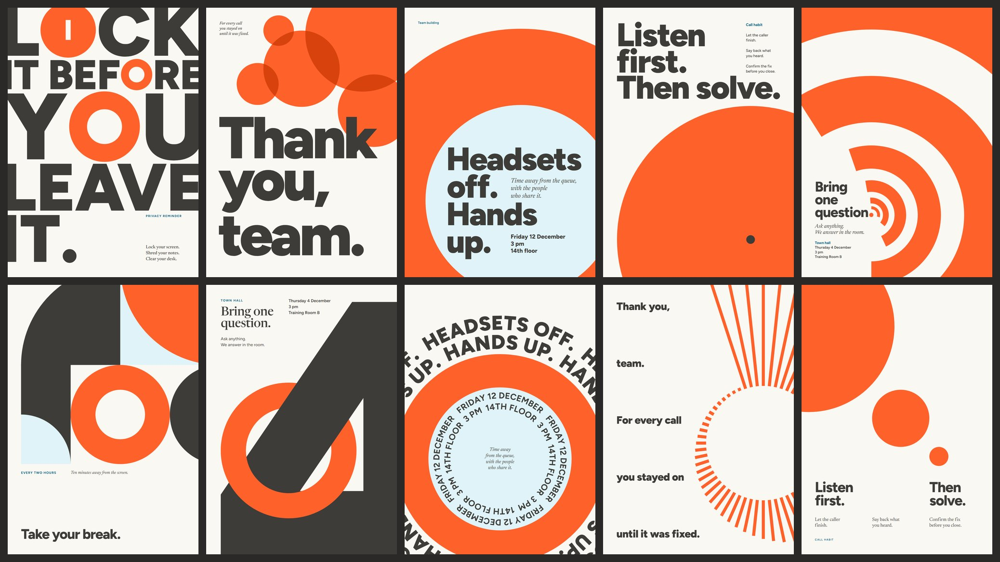

# The ten studies

These are not the posters the Studio draws. They are the studies that came before it: ten designers each built one poster from a move found in real poster work, with the orange ring as the hero. The notes they worked from are in [`NOTES.md`](NOTES.md).

Two judges scored each study out of 40 (authored, idea, theme, reads; 10 each), one as a competition juror and one as someone walking past it on the floor.

| Study | Move | Score |
|---|---|---|
| [`o-as-letter`](o-as-letter) | The headline fills the sheet and the O's are rings | 26.5 |
| [`type-rings`](type-rings) | Words set on rings round the O | 25 |
| [`radial`](radial) | Strokes round an empty O | 25 |
| [`giant-o`](giant-o) | A giant O with the words in its counter | 25 |
| [`numerals`](numerals) | The date as architecture, a ring through it | 24.5 |
| [`arcs`](arcs) | Arcs growing from the full stop | 24 |
| [`disc-cluster`](disc-cluster) | Overlapping discs over a stacked headline | 23.5 |
| [`disc-and-dot`](disc-and-dot) | One disc, one dot | 22.5 |
| [`discs-diagonal`](discs-diagonal) | Discs stepping down a diagonal | 21 |
| [`quarter-circles`](quarter-circles) | Interlocking quarter circles | 20.5 |

## What the judges agreed on

1. **Drop the blue.** Pale sky fills and teal labels read as a fourth and fifth colour. The theme is warm white, charcoal and one orange.
2. **The hero has to be a ring.** A disc is a dot; a ring with a real hole is the O. The lowest scores went to the studies built from discs and tiles.
3. **The facts were too small.** Date, time and place at 1.5 to 2 percent of the sheet cannot be found from a corridor or in a feed. Set them two to three times larger, in bold.
4. **One orange thing.** Where three O's or six discs were orange, none of them was the hero.

The eight layouts in [`../studio/engine.js`](../studio/engine.js) keep the six moves that scored best, add two built from the fixes, and apply all four points. The rules are in [`../skills/poster-design/references/big-o.md`](../skills/poster-design/references/big-o.md).
